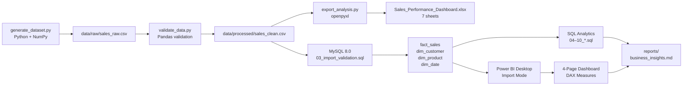

# Sales Performance Dashboard
### End-to-End Retail Analytics Portfolio Project
**Stack:** MySQL 8.0 · Python 3.x · Excel · Power BI Desktop

[](https://python.org)
[](https://dev.mysql.com)
[](https://powerbi.microsoft.com)
[](LICENSE)

> **Disclosure:** This project uses a **synthetic dataset** generated with Python
> (random seed = 42). It does NOT represent any real company, customer, or transaction.

---

## Table of Contents

1. [Project Overview](#project-overview)
2. [Business Problem](#business-problem)
3. [Objectives](#objectives)
4. [Technology Stack](#technology-stack)
5. [Dataset](#dataset)
6. [Architecture & Workflow](#architecture--workflow)
7. [Folder Structure](#folder-structure)
8. [Prerequisites](#prerequisites)
9. [Windows Setup Instructions](#windows-setup-instructions)
10. [Database Setup](#database-setup)
11. [SQL Execution Order](#sql-execution-order)
12. [Power BI Setup](#power-bi-setup)
13. [Data Model & DAX](#data-model--dax)
14. [Validation Procedure](#validation-procedure)
15. [Key Findings](#key-findings)
16. [Troubleshooting](#troubleshooting)
17. [Future Enhancements](#future-enhancements)
18. [Portfolio Summary](#portfolio-summary)
19. [Resume Bullets](#resume-bullets)
20. [Interview Questions & Answers](#interview-questions--answers)

---

## Project Overview

This project demonstrates a complete, production-style data analytics pipeline
for a fictional retail business. It covers every stage of the analytics lifecycle:
data generation → cleaning → database loading → SQL analysis → Excel reporting →
Power BI dashboard visualisation.

The project is designed to be a compelling portfolio artefact for B.Tech students
applying for Data Analyst / Business Intelligence roles.

---

## Business Problem

A retail business has accumulated 3 years of order-line data but lacks a structured
way to answer critical questions such as:

- Which regions and states drive the most revenue?
- Which products and categories are destroying margin?
- Is the business growing year-over-year?
- What is the impact of discount policies on profitability?
- Where should management focus investment?

---

## Objectives

1. Build a clean, queryable MySQL 8.0 database from raw CSV data.
2. Write production-quality SQL covering KPIs, trends, and advanced analytics.
3. Produce a formatted Excel workbook for business stakeholders.
4. Design a 4-page Power BI dashboard for executive decision-making.
5. Generate and document verified business insights.

---

## Technology Stack

| Layer | Tool | Purpose |
|:------|:-----|:--------|
| Data Generation | Python + NumPy + Faker | Synthetic dataset creation |
| Data Validation | Python + Pandas | Quality checks, baseline metrics |
| Excel Analytics | Python + openpyxl | Workbook creation; manual Excel analysis |
| Database | MySQL 8.0 | Star-schema storage, SQL analytics |
| Visualisation | Power BI Desktop | Interactive dashboards, DAX measures |
| Documentation | Markdown | All guides and reports |

---

## Dataset

| Field | Detail |
|:------|:-------|
| Type | Synthetic (clearly labelled) |
| Records | 7,500 order-line items |
| Orders | 4,360 unique orders |
| Customers | 795 unique customers |
| Products | 80 unique SKUs |
| Date Range | 2021-01-01 to 2023-12-31 |
| Total Sales | $3,333,386.08 |
| Total Profit | $224,989.95 |
| Profit Margin | 6.75% |
| Loss-making rows | 811 (10.8%) |
| Seed | 42 (fully reproducible) |

**Fields:** Row ID, Order ID, Order Date, Ship Date, Ship Mode, Customer ID,
Customer Name, Segment, Country, State, City, Region, Product ID, Category,
Sub-Category, Product Name, Sales, Quantity, Discount, Profit

---

## Architecture & Workflow



---

## Folder Structure

```
Sales-Performance-Dashboard/
├── README.md                          ← This file
├── requirements.txt                   ← Python dependencies
├── .gitignore
├── data/
│   ├── raw/
│   │   └── sales_raw.csv             ← Original generated dataset
│   ├── processed/
│   │   └── sales_clean.csv           ← Validated, cleaned dataset
│   ├── excel/
│   │   └── Sales_Performance_Dashboard.xlsx  ← 7-sheet workbook
│   ├── data_quality_report.md        ← Cleaning log and QA report
│   └── cleaning_log.md               ← Transformation decisions
├── sql/
│   ├── 01_create_database.sql        ← CREATE DATABASE
│   ├── 02_create_tables.sql          ← Star schema DDL
│   ├── 03_import_validation.sql      ← LOAD DATA + validation
│   ├── 04_kpi_analysis.sql           ← Overall KPIs
│   ├── 05_regional_analysis.sql      ← Regional & state performance
│   ├── 06_product_analysis.sql       ← Product top/bottom analysis
│   ├── 07_monthly_trends.sql         ← MoM, YoY, running totals
│   ├── 08_category_profitability.sql ← Discount impact analysis
│   ├── 09_advanced_analysis.sql      ← CTEs, RFM, window functions
│   └── 10_views.sql                  ← 7 reusable SQL views
├── scripts/
│   ├── generate_dataset.py           ← Dataset generator (seed=42)
│   ├── validate_data.py              ← Validation script (34 checks)
│   └── export_analysis.py            ← Excel workbook generator
├── powerbi/
│   ├── dashboard_design.md           ← Page layouts and visual configs
│   ├── dax_measures.md               ← All DAX measures with documentation
│   ├── data_model.md                 ← Star schema, relationships, setup
│   └── theme.json                    ← Custom Power BI colour theme
└── reports/
    ├── business_insights.md          ← 5 findings + 5 recommendations
    └── validation_results.md         ← Auto-generated validation report
```

---

## Prerequisites

| Software | Version | Download |
|:---------|:--------|:---------|
| Python | 3.10+ | https://python.org |
| MySQL Server | 8.0 | https://dev.mysql.com/downloads/mysql/ |
| MySQL Workbench | 8.0 | https://dev.mysql.com/downloads/workbench/ |
| Power BI Desktop | Latest | https://aka.ms/pbidesktopstore |
| MySQL Connector/NET | 8.x | https://dev.mysql.com/downloads/connector/net/ |
| Microsoft Excel | 2016+ | (Office 365) |

**Python packages:**
```
pandas>=2.0.0
numpy>=1.24.0
openpyxl>=3.1.0
faker>=18.0.0
```

---

## Windows Setup Instructions

### Step 1: Clone or set up the project directory
```powershell
# Open PowerShell as your user
cd "C:\Users\<your-username>\Documents"
# (Directory is already created at the path specified above)
```

### Step 2: Install Python packages
```powershell
pip install pandas numpy openpyxl faker
```

### Step 3: Generate the dataset
```powershell
cd "Sales-Performance-Dashboard"
python scripts/generate_dataset.py
```
Expected output: `data/raw/sales_raw.csv` and `data/processed/sales_clean.csv`

### Step 4: Run validation
```powershell
python scripts/validate_data.py
```
Expected: **34 PASS, 0 FAIL, 2 WARN**

### Step 5: Generate Excel workbook
```powershell
python scripts/export_analysis.py
```
Expected: `data/excel/Sales_Performance_Dashboard.xlsx` (7 sheets)

---

## Database Setup

### Install MySQL 8.0 on Windows

1. Download MySQL Installer from https://dev.mysql.com/downloads/installer/
2. Run installer → Select "Developer Default"
3. Set root password (remember it — do NOT commit to git)
4. Start MySQL service: **Services → MySQL80 → Start**

### Enable LOCAL INFILE (required for CSV import)

1. Open MySQL Workbench → Edit → Preferences → SQL Editor
   → Check **"Allow loading local data"**
2. Open `C:\ProgramData\MySQL\MySQL Server 8.0\my.ini` (as Administrator)
3. Under `[mysqld]`, add: `local_infile=ON`
4. Restart MySQL service

### Create database and load data

1. Open MySQL Workbench → Connect to localhost
2. Open and run scripts in order (File → Open SQL Script):

```
sql/01_create_database.sql    → Creates sales_performance database
sql/02_create_tables.sql      → Creates all tables with indexes
sql/03_import_validation.sql  → Loads CSV and validates counts
```

3. **In `03_import_validation.sql`, replace `<YOUR_ABSOLUTE_PATH>` with:**
   ```
   C:/Users/<your-username>/Documents/Sales-Performance-Dashboard
   ```
   (Use forward slashes even on Windows)

4. Run remaining analytics scripts:
   ```
   sql/04_kpi_analysis.sql
   sql/05_regional_analysis.sql
   ... through ...
   sql/10_views.sql
   ```

### Credentials security

> **Never** store your MySQL password in SQL files or commit it to git.
> Use MySQL Workbench's secure credential store or environment variables:
> ```powershell
> $env:MYSQL_PWD = "your_password"
> ```

---

## SQL Execution Order

| Step | File | Purpose |
|:-----|:-----|:--------|
| 1 | `01_create_database.sql` | Create database |
| 2 | `02_create_tables.sql` | Create schema |
| 3 | `03_import_validation.sql` | Load data + validate |
| 4 | `04_kpi_analysis.sql` | Overall KPIs |
| 5 | `05_regional_analysis.sql` | Regional analysis |
| 6 | `06_product_analysis.sql` | Product analysis |
| 7 | `07_monthly_trends.sql` | Time trends |
| 8 | `08_category_profitability.sql` | Category margins |
| 9 | `09_advanced_analysis.sql` | Advanced SQL |
| 10 | `10_views.sql` | Create views |

---

## Power BI Setup

### Open the dashboard project

The ready-to-open Power BI Desktop project is `powerbi/SalesPerformanceDashboard.pbip`.
Open it in Power BI Desktop, select **Home → Refresh** to load the included CSV, then
use **File → Save as** to create a `.pbix` copy for sharing or presenting. The project
includes the cleaned synthetic dataset at `powerbi/sales_clean.csv` and a single-page
report with sales, profit, order, and margin KPIs plus monthly, regional, and category
visuals.

If you clone this repository to a different folder, update the CSV path in
`powerbi/SalesPerformanceDashboard.SemanticModel/definition/expressions.tmdl`
to the cloned location before refreshing the report.

### 1. Install MySQL Connector
Download and install: https://dev.mysql.com/downloads/connector/net/
Select **MySQL Connector/NET 8.x**

### 2. Connect Power BI to MySQL
1. Power BI Desktop → **Home → Get Data → More → Database → MySQL Database**
2. Server: `localhost` | Database: `sales_performance`
3. Select Import mode (recommended)
4. Import tables: `fact_sales`, `dim_customer`, `dim_product`, `dim_date`
5. Import views: `v_monthly_sales`, `v_regional_performance`, `v_state_performance`,
   `v_product_performance`, `v_category_summary`, `v_discount_impact`

### 3. Apply custom theme
**View → Themes → Browse for themes → select `powerbi/theme.json`**

### 4. Create Calendar table
In **Modeling → New Table**, paste the DAX formula from `powerbi/dax_measures.md`
Section 5. Then mark it as date table:
**Table Tools → Mark as date table → Date column = Calendar[Date]**

### 5. Set relationships
All relationships are documented in `powerbi/data_model.md`.
Set cross-filter direction: **Single (dimension → fact)** for all relationships.

### 6. Create all measures
Copy-paste all DAX measures from `powerbi/dax_measures.md` into your model.

### 7. Build dashboard pages
Follow the layout specifications in `powerbi/dashboard_design.md`:
- Page 1: Executive Overview
- Page 2: Regional Analysis
- Page 3: Product & Profitability
- Page 4: Trends & Growth

---

## Data Model & DAX

See `powerbi/data_model.md` for the full star schema diagram and relationship table.
See `powerbi/dax_measures.md` for all 15+ DAX measures with documentation.

**Key measures:**
- `[Total Sales]`, `[Total Profit]`, `[Profit Margin %]`
- `[MoM Growth %]` using DATEADD + LAG pattern
- `[YoY Growth %]` using SAMEPERIODLASTYEAR
- `[Sales Contribution %]` using ALL() to clear filter context

---

## Validation Procedure

1. Run the Python validation script:
   ```powershell
   python scripts/validate_data.py
   ```
   Expected: 34 PASS, 0 FAIL, 2 WARN (see `reports/validation_results.md`)

2. After MySQL import, run Q1 in `04_kpi_analysis.sql` and verify:
   - total_records = 7,500
   - total_orders = 4,360
   - total_sales ≈ $3,333,386.08
   - total_profit ≈ $224,989.95
   - profit_margin_pct ≈ 6.75

3. In Power BI, verify that the KPI cards match these baseline numbers
   (without any slicers active).

---

## Key Findings

1. **Technology dominates revenue** (71.8% share) but Office Supplies has the
   highest margin (21.57% vs 6.94% for Technology).
2. **Furniture Tables sub-category is loss-making** (−$5,276 total profit).
3. **Discounts above 20% consistently destroy profit** — 17.9% of orders are
   above this threshold yet they generate aggregate losses.
4. **South region has the highest profit margin** (7.10%) despite the lowest sales.
5. **Q4 seasonality is strong and consistent** — November and December peak
   each year by 20–30% above the monthly average.

See `reports/business_insights.md` for full analysis and 5 recommendations.

---

## Troubleshooting

| Problem | Solution |
|:--------|:---------|
| `UnicodeEncodeError` in Python | Run with `$env:PYTHONIOENCODING='utf-8'` |
| `ERROR 3948: Loading local data is disabled` | Enable `local_infile=ON` in my.ini |
| MySQL Workbench can't connect | Check MySQL80 service is running in Services |
| Power BI MySQL connector not found | Install MySQL Connector/NET from dev.mysql.com |
| Map shows incorrect states | Set Data Category = State/Province on state column |
| DAX measure returns BLANK | Check Calendar table is marked as date table |
| `pip` not found | Add Python to PATH during installation |

---

## Future Enhancements

1. **Customer Lifetime Value (CLV)** analysis using historical order frequency
2. **Inventory turnover simulation** by linking quantity to estimated stock levels
3. **Cohort analysis** — track customers by first-purchase month
4. **Forecasting** — add Python Prophet or Power BI's forecasting visual
5. **Real dataset** — replace synthetic data with public Kaggle Superstore dataset
6. **Automated refresh** — schedule Power BI dataset refresh via Power BI Service
7. **Row-Level Security (RLS)** — restrict regional managers to their region's data
8. **Azure integration** — migrate MySQL to Azure SQL Database

---

## Portfolio Summary

**Project Title:** Retail Sales Performance Dashboard — SQL, Power BI & Excel

**Summary:** Built an end-to-end retail analytics solution using MySQL 8.0,
Python, Excel, and Power BI. Generated and validated a 7,500-record synthetic
retail dataset, designed a star-schema database, wrote 10 SQL scripts covering
KPIs, trends, and advanced analytics, produced a formatted 7-sheet Excel workbook,
and designed a 4-page Power BI dashboard with 15+ DAX measures. Identified key
insights including a loss-making furniture sub-category and the profit-eroding
impact of discounts above 20%.

---

## Resume Bullets

1. **Designed and implemented an end-to-end retail sales analytics pipeline** using
   MySQL 8.0 (star schema), Python (pandas/openpyxl), Excel, and Power BI Desktop,
   processing 7,500 synthetic order records to surface actionable business insights.

2. **Authored 10 SQL scripts featuring CTEs, window functions (LAG, RANK, NTILE,
   running totals), conditional aggregation, and JOINs** across fact and dimension
   tables; identified a loss-making furniture sub-category (Tables, −$5,276 profit)
   and confirmed that discounts above 20% consistently erode margins.

3. **Built a 4-page Power BI dashboard with 15+ DAX measures** including time
   intelligence (MoM/YoY growth using DATEADD, SAMEPERIODLASTYEAR), customer
   contribution analysis, and product sales ranking; applied a star-schema data
   model with a proper Calendar dimension table.

4. **Produced a data-backed business insights report** identifying Q4 seasonality
   trends, regional margin disparities (South 7.10% vs East 6.56%), and a
   $80,000+ opportunity from capping discounts — demonstrating ability to translate
   raw data into strategic recommendations.

---

## Interview Questions & Answers

### Q1. Why did you use a star schema instead of a flat table?

**Answer:** A star schema separates facts (measurements) from dimensions (context),
eliminating redundancy and enabling efficient analytical queries. In a flat table,
customer and product data repeat for every order line, wasting storage and making
updates error-prone. The star schema allows Power BI slicers on any dimension to
correctly filter the fact table via relationship propagation, and enables DAX
time intelligence through a proper date dimension.

---

### Q2. How do you calculate profit margin — what's the correct method?

**Answer:** The correct method for a period or group is the **aggregate margin**:
`SUM(profit) / SUM(sales)`. Using the average of row-level margins
(`AVG(profit/sales)`) is misleading because it gives equal weight to a $10
transaction and a $10,000 transaction. In our dataset, the correct margin is
6.75% while the row-average method would give a misleading 15.85%.

---

### Q3. What is the purpose of `NULLIF()` in your SQL queries?

**Answer:** `NULLIF(denominator, 0)` prevents division-by-zero errors by returning
NULL when the denominator is 0. NULL divided by anything in SQL returns NULL
(rather than throwing an error), which then displays cleanly as NULL or can be
handled with `COALESCE()`. I used it extensively in margin calculations:
`SUM(profit) / NULLIF(SUM(sales), 0)`.

---

### Q4. Explain the difference between Import and DirectQuery in Power BI.

**Answer:** **Import mode** loads a snapshot of data into Power BI's in-memory
VertiPaq engine. Queries run very fast but data is only as fresh as the last
refresh. **DirectQuery** sends native queries to the source database on every
interaction — always live but potentially slower. For this portfolio project
(7,500 rows, no live update requirement), Import mode is the correct choice.
DirectQuery is preferred for large datasets (>10M rows) or real-time operational
dashboards.

---

### Q5. What is a DAX filter context, and how does it affect your measures?

**Answer:** Filter context is the set of active filters applied to a visual
or calculation. When a slicer selects "East" region, the filter context
restricts all measures to East rows only. Measures like `[Sales Contribution %]`
use `ALL()` to remove specific filter context and calculate the grand total:
`DIVIDE([Total Sales], CALCULATE([Total Sales], ALL(fact_sales[region])), 0)`.
This correctly shows East's share as a percentage of total, not 100%.

---

### Q6. How did you handle the ship_date vs order_date in the data model?

**Answer:** Both dates needed to join to the same dim_date table, but Power BI
only allows one active relationship between two tables. I set `order_date_key`
as the active relationship (used by default for all time intelligence) and
`ship_date_key` as inactive. To use shipping date in analysis, I would use
`USERELATIONSHIP(fact_sales[ship_date_key], dim_date[date_key])` inside a
`CALCULATE()` statement.

---

### Q7. What are window functions, and which ones did you use?

**Answer:** Window functions perform calculations across a set of rows related
to the current row, without collapsing the result like GROUP BY does. I used:
- **LAG()** — to get the previous month's sales for MoM growth calculation
- **RANK() / DENSE_RANK()** — to rank products and regions by sales/profit
- **NTILE(4/5)** — to assign performance quartiles and RFM scores
- **SUM() OVER ()** — for running/cumulative totals across months

---

### Q8. The Tables sub-category has negative profit despite $253K in sales. What would you recommend?

**Answer:** My recommendation involves three steps: (1) Investigate whether
the losses are discount-driven, cost-driven, or pricing-driven — the SQL analysis
shows high average discounts on Tables. (2) Identify the specific SKUs responsible
(Flash Furniture Folding Table, Lifetime 6-Foot Table). (3) Either reprice these
products upward to cover costs, renegotiate supplier pricing, or discontinue the
3–4 loss-making SKUs. I would also caution that correlation (high discounts → losses)
does not prove causation — a controlled pricing experiment would be needed.

---

### Q9. How do you ensure your analysis is reproducible?

**Answer:** Reproducibility is built into the project at three levels:
(1) The synthetic dataset uses a fixed random seed (`SEED = 42`), producing
identical data every time. (2) All SQL scripts are idempotent (they use
`DROP IF EXISTS` before `CREATE`). (3) The Python validation script checks
actual values against documented expected values, so any regression is
immediately caught. The validation report documents 34 specific checks.

---

### Q10. What would you do differently if this were a production project?

**Answer:** Several things: (1) Replace the synthetic dataset with real
transactional data with proper PII anonymisation. (2) Add Row-Level Security
in Power BI so regional managers only see their region. (3) Set up automated
Power BI Service refresh on a schedule. (4) Add data lineage documentation
using a tool like dbt. (5) Implement proper CI/CD for SQL — use a migration
tool (like Flyway) instead of ad-hoc scripts. (6) Add monitoring: alert when
profit margin drops below a threshold. (7) Validate MySQL-to-Power BI numbers
automatically in a nightly reconciliation job.
